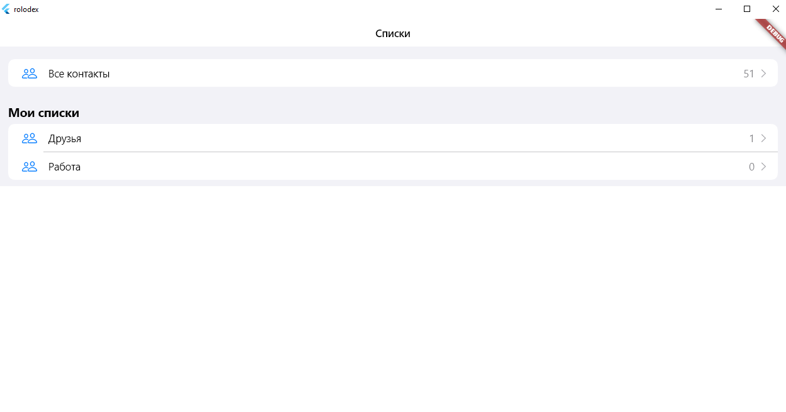
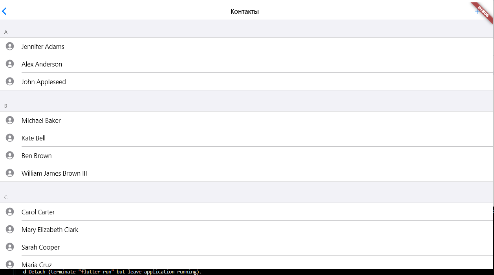
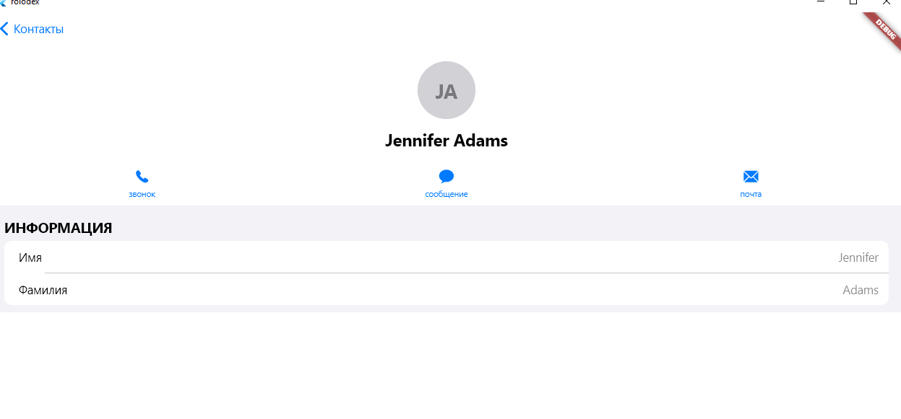
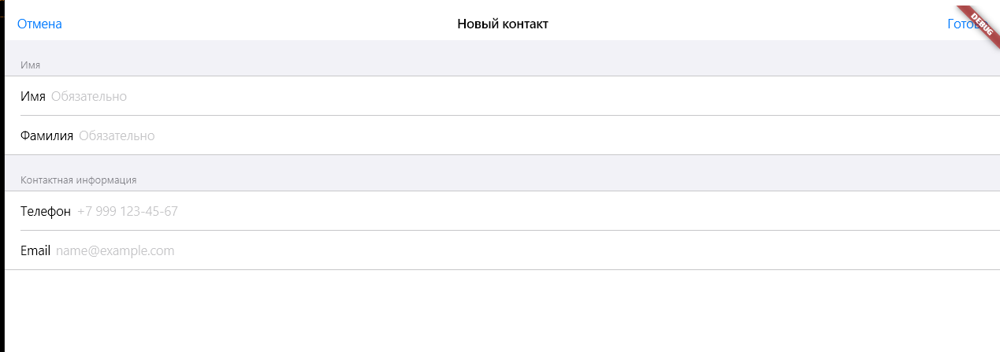
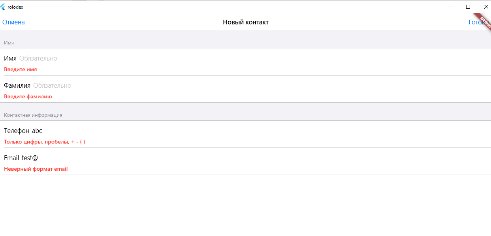
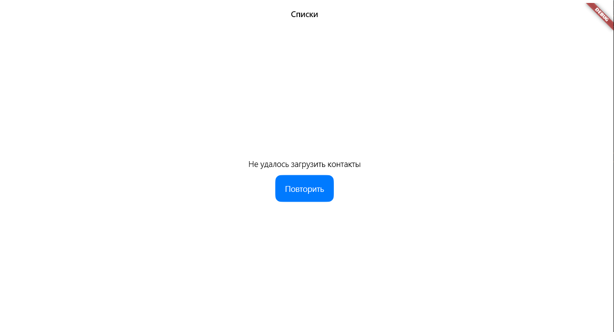

# Rolodex

Учебное приложение «Контакты» на Flutter (Cupertino). Практические задания
индивидуального плана:

- **Этап 3. Flutter Core**: несколько экранов с навигацией и форма ввода
  с валидацией;
- **Этап 4. State Management**: загрузка данных с состояниями «загрузка /
  данные / ошибка» на Cubit (`flutter_bloc`).

## Экраны

| Экран | Файл | Что показывает |
|---|---|---|
| Списки | `lib/screens/groups_screen.dart` | группы контактов в двух секциях (системная и «Мои списки») с количеством контактов |
| Контакты группы | `lib/screens/contacts_screen.dart` | контакты группы с разбивкой по первой букве фамилии, кнопка «+» для добавления |
| Карточка контакта | `lib/screens/contact_detail_screen.dart` | аватар с инициалами, ряд кнопок действий, поля контакта |
| Новый контакт | `lib/screens/contact_form_screen.dart` | форма с валидацией |

## Скриншоты

| Списки | Контакты группы |
|---|---|
|  |  |

| Карточка контакта | Новый контакт |
|---|---|
|  |  |

Ошибки валидации (пустые имя и фамилия, телефон `abc`, email `test@`):



## Навигация

```
Списки ──► Контакты группы ──► Карточка контакта
                │
                └──(+)──► Новый контакт ──(Готово)──► контакт возвращается в список
```

- переходы через `Navigator.push` и `CupertinoPageRoute`;
- данные передаются через конструктор экрана (`groupId`, `contact`);
- форма открывается модально (`fullscreenDialog: true`) и возвращает
  результат через `Navigator.pop(contact)`.

## Форма и валидация

- `Form` + `GlobalKey<FormState>`, поля `CupertinoTextFormFieldRow`;
- `autovalidateMode: AutovalidateMode.onUserInteraction`: ошибка появляется
  сразу при вводе;
- правила проверки вынесены в `lib/utils/validators.dart`:
  - имя и фамилия обязательны, не длиннее 50 символов;
  - телефон необязателен; если заполнен, то только цифры, пробелы, `+ - ( )`,
    от 10 до 15 цифр;
  - email необязателен; если заполнен, то в формате `name@example.com`.

## Управление состоянием (этап 4)

Подход: **Cubit** из пакета `flutter_bloc`, состояния описаны sealed-классом
на `equatable`.

### Схема

```
FakeContactsRepository ──► ContactGroupsCubit ──emit(state)──► BlocBuilder ──► экраны
   (задержка 1.5 с,          loadContactGroups()                 GroupsScreen
    ошибка в 30% случаев)    addContact()                        ContactsScreen
                             nextContactId()
```

| Слой | Файл | Ответственность |
|---|---|---|
| Репозиторий | `lib/data/contacts_repository.dart` | интерфейс `ContactsRepository` и `ContactsLoadException` |
| Фейковая реализация | `lib/data/fake_contacts_repository.dart` | имитирует сеть: задержка и случайная ошибка, оба параметра настраиваются |
| Состояния | `lib/data/contact_groups_state.dart` | `sealed class ContactGroupsState`: `Loading`, `Loaded(groups)`, `Error(message)` |
| Cubit | `lib/data/contact_groups_cubit.dart` | загрузка групп, добавление контакта, следующий id |
| UI | `lib/screens/groups_screen.dart`, `contacts_screen.dart` | `BlocBuilder` и исчерпывающий `switch` по состоянию |

### Состояния экрана «Списки»

| Состояние | Что видит пользователь |
|---|---|
| `ContactGroupsLoading` | индикатор загрузки |
| `ContactGroupsError` | «Не удалось загрузить контакты» и кнопка «Повторить» |
| `ContactGroupsLoaded` | группы контактов со счётчиками |

| Загрузка | Ошибка | Данные |
|---|---|---|
|  |  |  |

### Решения

- **Cubit, а не Bloc**: событий немного (загрузить, добавить контакт),
  отдельные классы событий были бы лишним кодом.
- **Sealed-состояния**: невозможные комбинации (одновременно «загрузка»
  и «ошибка») исключены типами, а `switch` в UI проверяется компилятором
  на полноту.
- **`Equatable`**: состояния сравниваются по значению, поэтому одинаковые
  состояния не перерисовывают UI, а тесты сравнивают их напрямую.
- **Внедрение зависимостей**: репозиторий передаётся в cubit через
  конструктор, а в приложение — через `RolodexApp(repository: ...)`. В тестах
  подставляется детерминированный фейк (`delay: Duration.zero`,
  `shouldFail: () => true/false`).
- **`BlocProvider` над `CupertinoApp`**: cubit доступен на всех экранах,
  открытых через `Navigator.push`.
- **Проверка `isClosed` после `await`**: если cubit закрыли во время загрузки,
  `emit` не вызывается.
- **Повтор после ошибки** снова показывает индикатор загрузки:
  `loadContactGroups()` начинается с `emit(Loading)`.

### Как воспроизвести ошибку

Ошибка выпадает примерно при каждом третьем запуске. Чтобы получить её
гарантированно, временно поменяй в `lib/main.dart`:

```dart
runApp(RolodexApp(repository: FakeContactsRepository(shouldFail: () => true)));
```

После изменения `main()` нужен hot restart (`R`), hot reload его не применит.

## Структура

```
lib/
  main.dart
  data/       модели, репозиторий, состояния и cubit
  screens/    экраны
  widgets/    строки списков
  utils/      валидаторы
test/         unit- и widget-тесты
```

## Запуск

```bash
flutter pub get
flutter run
```

## Тесты

```bash
flutter test
```

- `validators_test.dart`: все ветки валидаторов;
- `contact_groups_cubit_test.dart`: последовательности состояний при загрузке,
  ошибке и повторе, закрытие cubit во время загрузки, `addContact`,
  `nextContactId` (`bloc_test`);
- `groups_screen_test.dart`: экран «Списки» в состояниях загрузки, ошибки
  и данных, кнопка «Повторить»;
- `contact_form_test.dart`: ошибки валидации, сохранение и отмена формы;
- `app_flow_test.dart`: сквозной сценарий добавления контакта в группу.
