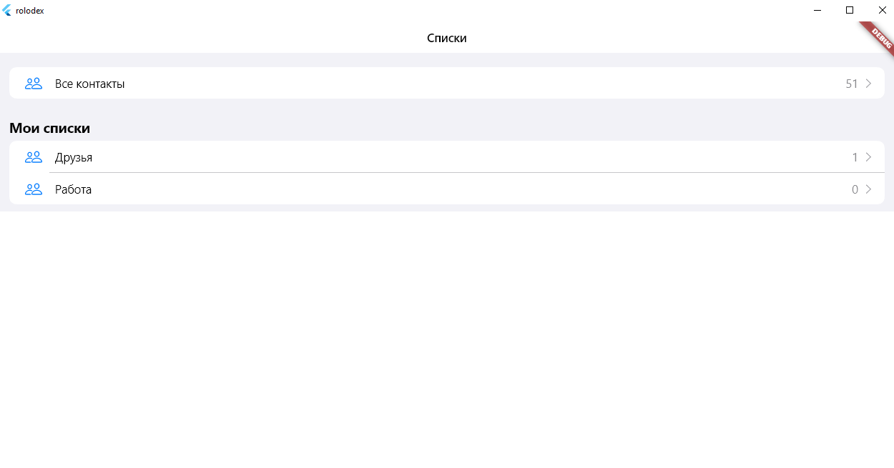
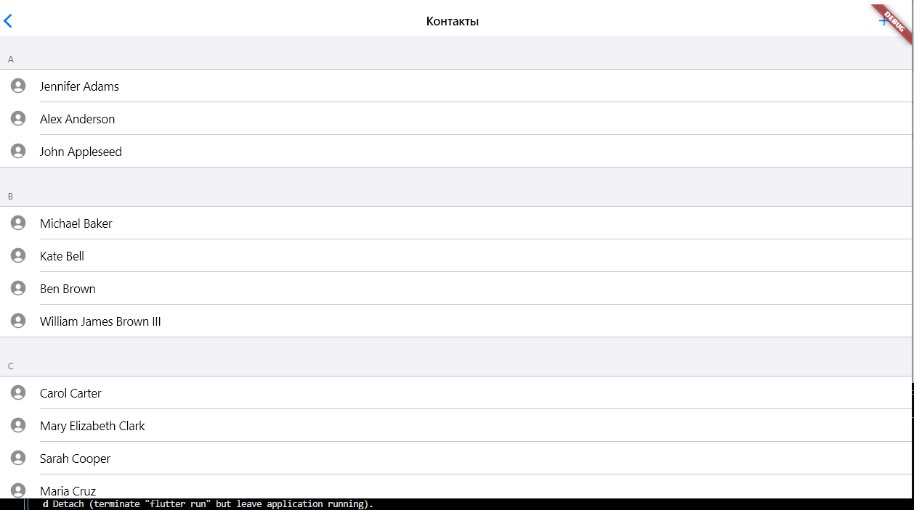
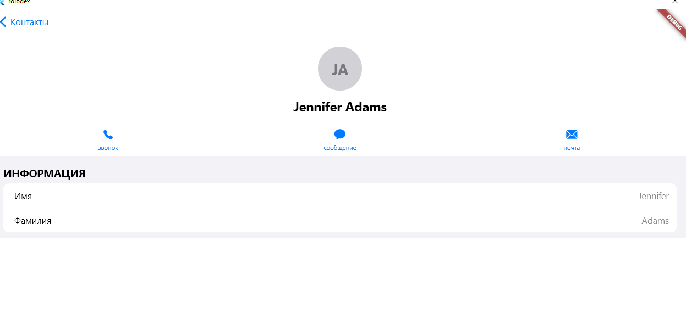
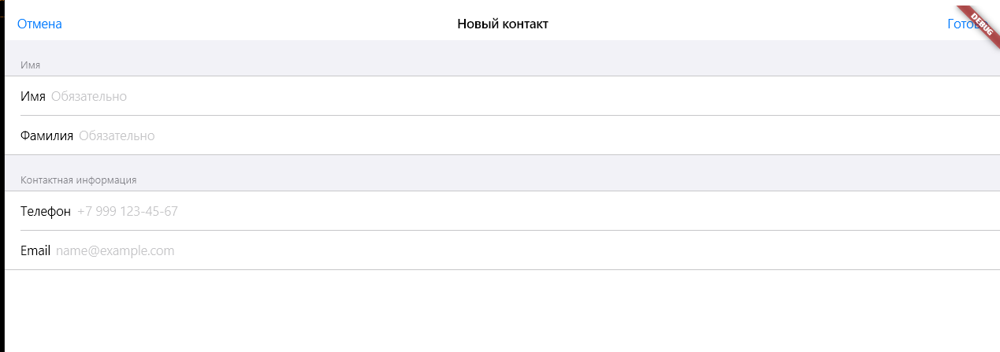
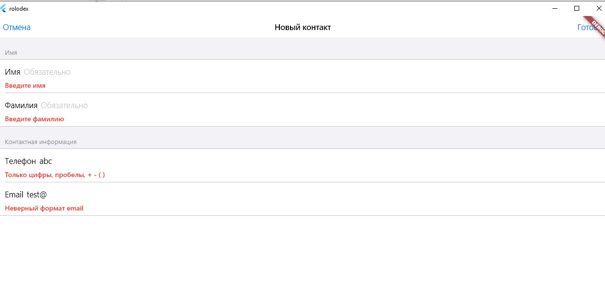

# Rolodex

Учебное приложение «Контакты» на Flutter (Cupertino). Практическое задание
этапа «Flutter Core: widgets, layout, navigation, forms»: несколько экранов
с навигацией между ними и форма ввода с валидацией.

## Экраны

| Экран | Файл | Что показывает |
|---|---|---|
| Списки | `lib/screens/groups_screen.dart` | группы контактов в двух секциях (системная и «Мои списки») с количеством контактов |
| Контакты группы | `lib/screens/contacts_screen.dart` | контакты группы с разбивкой по первой букве фамилии, кнопка «+» для добавления |
| Карточка контакта | `lib/screens/contact_detail_screen.dart` | аватар с инициалами, ряд кнопок действий, поля контакта |
| Новый контакт | `lib/screens/contact_form_screen.dart` | форма с валидацией |

## Скриншоты

| Списки | Контакты группы |
|---|---|
|  |  |

| Карточка контакта | Новый контакт |
|---|---|
|  |  |

Ошибки валидации (пустые имя и фамилия, телефон `abc`, email `test@`):



## Навигация

```
Списки ──► Контакты группы ──► Карточка контакта
                │
                └──(+)──► Новый контакт ──(Готово)──► контакт возвращается в список
```

- переходы через `Navigator.push` и `CupertinoPageRoute`;
- данные передаются через конструктор экрана (`groupId`, `contact`);
- форма открывается модально (`fullscreenDialog: true`) и возвращает
  результат через `Navigator.pop(contact)`.

## Форма и валидация

- `Form` + `GlobalKey<FormState>`, поля `CupertinoTextFormFieldRow`;
- `autovalidateMode: AutovalidateMode.onUserInteraction`: ошибка появляется
  сразу при вводе;
- правила проверки вынесены в `lib/utils/validators.dart`:
  - имя и фамилия обязательны, не длиннее 50 символов;
  - телефон необязателен; если заполнен, то только цифры, пробелы, `+ - ( )`,
    от 10 до 15 цифр;
  - email необязателен; если заполнен, то в формате `name@example.com`.

## Состояние

`ContactGroupsModel` (`lib/data/contact_group.dart`) хранит группы
в `ValueNotifier`. Экраны подписаны через `ValueListenableBuilder`, поэтому
после добавления контакта списки и счётчики обновляются сами.

## Структура

```
lib/
  main.dart
  data/       модели и состояние
  screens/    экраны
  widgets/    строки списков
  utils/      валидаторы
test/         unit- и widget-тесты
```

## Запуск

```bash
flutter pub get
flutter run
```

## Тесты

```bash
flutter test
```

- `validators_test.dart`: все ветки валидаторов;
- `contact_group_model_test.dart`: добавление контакта и уведомление слушателей;
- `contact_form_test.dart`: ошибки валидации, сохранение и отмена формы;
- `app_flow_test.dart`: сквозной сценарий добавления контакта в группу.
